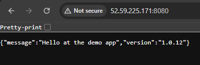
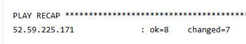
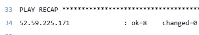
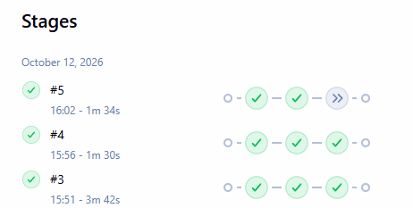

# devops-ansible-ec2

A Jenkins pipeline that creates an AWS EC2 server with Terraform, configures it
with Ansible, and runs a containerised demo app on it. One build parameter
(`deploy` or `destroy`) creates or removes everything.

## Architecture

Jenkins -> Terraform (EC2 + key pair + security group) -> Ansible (Docker + Compose) -> app on port 8080

## Pipeline

| Stage | Tool | What it does |
|-------|------|--------------|
| Provision (Terraform) | Terraform | Applies or destroys the infrastructure. On deploy, writes the public IP to `ec2_ip.txt` |
| Configure (Ansible) | Ansible | Builds the inventory from that IP, installs Docker and the Compose plugin, starts the app |

The `ACTION` parameter selects `deploy` or `destroy`. On destroy, the Configure
stage is skipped.

Builds #3 and #4 are deploys. Build #5 is a destroy, so Configure is skipped.

## Idempotency

The playbook was run twice against the same server.

The first run reported `ok=8 changed=7`. The second reported `ok=8 changed=0`,
because each task checks the server's current state before acting. The
second build also finished in 1m 30s, against 3m 42s for the first.

## Result

## Credentials

| Jenkins credential ID | Type | Used for |
|-----------------------|------|----------|
| `aws-access-key-id` | Secret text | Terraform AWS access |
| `aws-secret-access-key` | Secret text | Terraform AWS access |
| `ec2-public-key` | Secret file | Public key registered on the instance |
| `ec2-ssh-key` | SSH private key | Ansible connection to the instance |

No secrets are stored in the repo. Copy `terraform/ec2/terraform.tfvars.example`
if you want to run Terraform locally.

## Design decisions

- **Terraform and Ansible are separate.** Terraform owns the infrastructure
  lifecycle, and Ansible owns what runs inside the server. Either can change
  without touching the other.
- **State is remote.** Terraform state is stored in an S3 bucket with
  encryption and native lockfile locking, so a destroy build works from any
  Jenkins workspace and two runs cannot corrupt the state.
- **The inventory is generated at build time** from Terraform's output,
  because a new instance's IP isn't known in advance.
- **SSH (22) and the app (8080) are open only to the caller's IP.** The pipeline
  looks up its public IP and passes it to Terraform as a /32 CIDR.
- **IMDSv2 is required** on the instance (`http_tokens = "required"`).
- **Credentials stay in Jenkins** and are injected only for the steps that
  need them.
- **Docker Compose runs the app,** so the app definition is a file in the repo.

## Known limitations

- The Compose plugin is downloaded from the `latest` release, so it is not pinned.
- SSH uses `StrictHostKeyChecking=accept-new`, which suits a short-lived
  demo server but is not a hardened setting.
- The instance sits in the default VPC with a public IP, which is fine for a demo.

## Cost and cleanup

Run with `ACTION=destroy` when finished. The instance was terminated and
confirmed in the EC2 console after testing. An AWS budget alert guards against
forgotten resources.